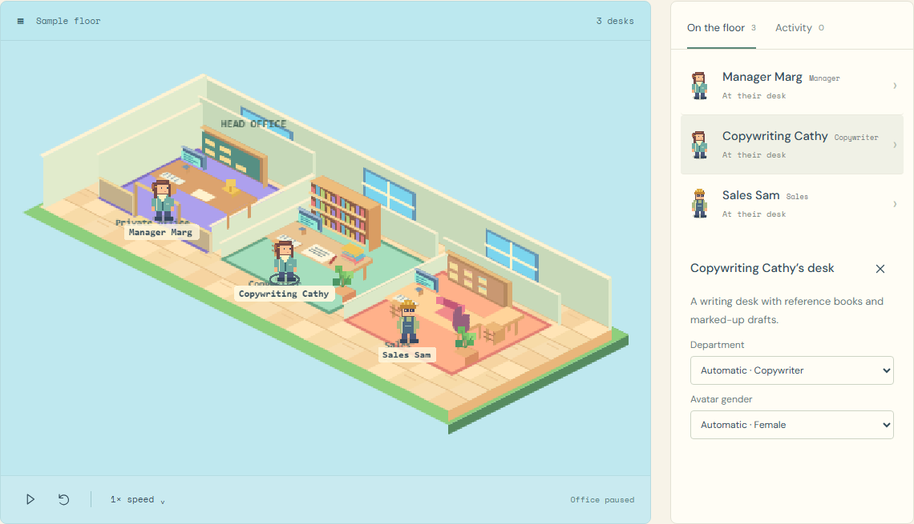

# Grok Bot Office

I wanted to see what my Grok bots were working on without asking each one for an update. So I gave them a little pixel office. In the demo, Copywriting Cathy has a writing desk, Sales Sam has a phone, and Manager Marg has her own office.

I chose the rooms and the way teammates walk between desks. I used AI to help write and test the app.



| Platform | Sample office | Watch your own Grok bots |
| --- | --- | --- |
| Windows | Yes | Yes, with Grok Bot open on the same PC |
| macOS | Yes | Demo only |
| Linux | Yes | Demo only |

## Run it

Run these commands from the project directory with Node.js 24 LTS.

```sh
npm ci
npm run office
```

Open the local address printed in the terminal, usually [127.0.0.1:3000](http://127.0.0.1:3000). The sample starts with three teammates. Click a character to inspect their desk, or choose **Edit sample team** to try a different floor plan.

## Set up a teammate

Click a bot on the floor or in the roster. **Department** controls the room and its furniture. The office starts with a department suggested by a visible job title or the bot's name. For example, “Sales Manager Sam” gets a sales desk. An unrecognised title gets a general workspace.

**Avatar gender** controls the character on the floor and its portrait in the roster. A local list of names suggests the starting look. Cathy and Marg get female avatars. Shared names such as Sam and unfamiliar names start with a neutral avatar. You can choose **Female**, **Male**, or **Neutral** yourself. Both settings have an **Automatic** option and apply only to this office session.

## Watch your team on Windows

1. Open the Grok Bot desktop app, sign in and expand the **Bots** sidebar.
2. In the office, choose **Connect Grok Bot** → **Watch desktop team**.
3. Select a teammate to see their status. To show a current task title, open that bot's **Conversation details → Activity** in Grok Bot.

Watching uses zero xAI API credits. The local server uses Windows UI Automation to read names and status labels such as **Working** and **Needs attention** from the open window. It checks again about six seconds after each read. Task details stay in memory. **Disconnect** stops the checks and takes you back to the demo.

The reader understands Grok Bot's English desktop labels. It can only show what the app exposes. An unreported task shows up as **No activity shown**. Some versions of Grok Bot give group chats the same sidebar labels as bots. Use **Choose desks** to leave those chats off the floor.

The connector uses the desktop window because Grok Bot has no public API for listing the bots in a signed-in account. [Cursor's explanation](https://forum.cursor.com/t/grok-bot-official-api-to-create-bots-and-send-receive-chat-for-companion-uis/170985/6)

## Development

`npm run dev` starts the same local server as `npm run office`. Both bind to `127.0.0.1`. For a production build, run `npm run build` and `npm start`. If you're running that build on your Windows PC and want to use the desktop reader, set `GROK_DESKTOP_OBSERVER=1` before starting it and keep it bound to loopback.

```sh
npm test
npm run typecheck
npm run build
npx playwright install chromium
npm run test:e2e
```

The browser tests use a sample desktop feed. They run without a Grok account or API key.

## Artwork

PixiJS draws the rooms and furniture. The character sprites are in `public/office/`. To redraw them, install Pillow and run `python scripts/draw-office.py`. The visual design draws on [unslop by Damir Sokolovsky](https://heydamir.design/unslop), licensed under CC BY 4.0.
